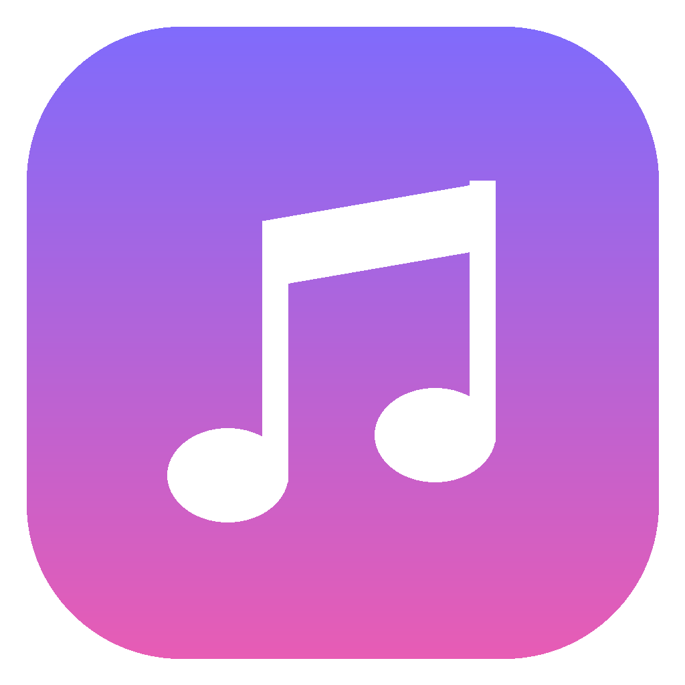
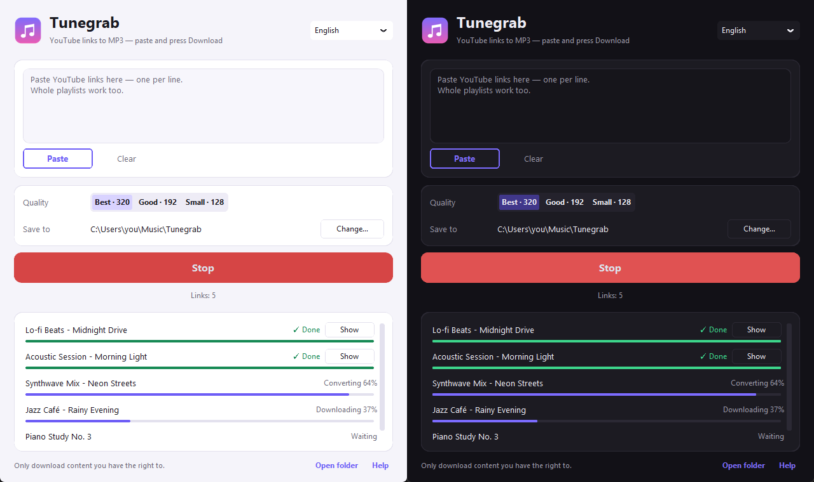
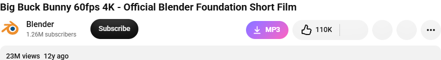

<div align="center">



# Tunegrab

**YouTube links → MP3. Paste, press one button, done.**

A tiny, free Windows app with an optional MP3 button for your browser. No ads, no account.

[](https://github.com/BukazLucky/tunegrab/releases/latest/download/Tunegrab.exe)

[](https://github.com/BukazLucky/tunegrab/releases/latest)
[](https://github.com/BukazLucky/tunegrab/releases)
[](LICENSE)

**English** · [Русский](README.ru.md)



</div>

## How to use

1. **Download** `Tunegrab.exe` with the button above and open it. Nothing to install.
2. **Copy** a YouTube link. Tunegrab picks it up from the clipboard automatically (or press **Paste**).
3. Press **Download MP3**. Files land in `Music\Tunegrab`. Click **Show** to open one.

That's it.

## MP3 button in your browser (optional)



Install the **Tunegrab: MP3 button** extension and an MP3 button appears next to Like on every YouTube video
(floating in the corner on Shorts and playlists). One click and Tunegrab starts downloading. You can also right-click
any YouTube link, or click the Tunegrab icon in the toolbar. The extension needs the Tunegrab app and collects no data
([privacy](PRIVACY.md)).

**Install from GitHub (Chrome, Edge, Opera, Yandex, Brave):**
1. Download `tunegrab-extension-chromium-….zip` from the [latest release](https://github.com/BukazLucky/tunegrab/releases/latest) and unzip it into a folder you'll keep.
2. Open `chrome://extensions` (Edge: `edge://extensions`) and turn on **Developer mode**.
3. Click **Load unpacked** and pick the unzipped folder.
4. Open a YouTube video, click **MP3**, and when the browser asks to open Tunegrab, tick **Always allow**.

## Features

- **One window, one button.** No settings you have to understand.
- **Playlists and many links at once.** Paste a whole playlist or a list of links, one per line.
- **Clean files.** Title, artist and cover art are added to every MP3, so it looks right in any player and on your phone.
- **Quality you choose:** 320, 192 or 128 kbps.
- **Smart about links.** Picks links out of any copied text, ignores duplicates, and a song opened from a "Mix" downloads just that song, not the whole endless mix.
- **Skips what you already have.** Songs that are already in the folder are not downloaded again.
- **Keeps itself working.** The download engine updates itself once a day, so it keeps working when YouTube changes things.
- **11 languages**, picked automatically from your Windows language: English, Español, Português, Deutsch, Français, Italiano, Polski, Türkçe, Українська, Русский, 简体中文.
- **Light and dark mode**, following Windows.
- **Browser button.** Optional extension: an MP3 button right on YouTube.

## First launch

**"Windows protected your PC"?** Tunegrab is a new app without a paid code-signing certificate, so Windows SmartScreen warns about it. Click **More info → Run anyway**. The full source code is in this repository, and you can [build the exe yourself](#build-from-source).

**One-time setup.** On the first launch Tunegrab downloads its download engine (about 65 MB) from the official
[yt-dlp](https://github.com/yt-dlp/yt-dlp/releases) and [Deno](https://github.com/denoland/deno/releases) releases
on GitHub and checks their SHA-256 checksums. This takes under a minute and happens only once.

## FAQ

**A download failed. What now?**
The message next to the song tells you why: private video, removed video, age-restricted, live stream, no internet.
If you see "Couldn't download" for many songs, YouTube probably changed something. Tunegrab updates its engine
automatically, so try again later or tomorrow.

**Can I download age-restricted or members-only videos?**
No. Those need you to be signed in to YouTube, and Tunegrab never asks for your account.

**Live streams?**
Not supported. Download the recording after the stream ends.

**Where are my files?**
`Music\Tunegrab` by default. Change it with **Change…** next to "Save to", or click the path to open the folder.

**Does Tunegrab collect any data?**
No. It talks to YouTube (to get the audio) and to GitHub (to download and update the engine, and to check for a new
Tunegrab version). No analytics, no accounts.

**My antivirus complains.**
Apps built with PyInstaller sometimes trigger false positives. You can check the file on
[VirusTotal](https://www.virustotal.com/), or build it from source.

**How do I uninstall?**
Delete `Tunegrab.exe` and the folder `%LOCALAPPDATA%\Tunegrab` (engine, settings and log).

**Something is broken. How do I report it?**
[Open an issue](https://github.com/BukazLucky/tunegrab/issues) and attach `%LOCALAPPDATA%\Tunegrab\tunegrab.log`.

## Build from source

Requires Windows and Python 3.12+.

```powershell
git clone https://github.com/BukazLucky/tunegrab.git
cd tunegrab
pip install -r requirements.txt
python tunegrab.pyw                                     # run it
powershell -ExecutionPolicy Bypass -File build.ps1      # build dist\Tunegrab.exe
```

The browser extension lives in `extension/`. `python tools/build_extension.py` packs it for Chromium browsers and Firefox.

**Adding a language:** copy `tunegrab/locales/en.json` to `<code>.json`, translate the values (keep `{placeholders}`),
add the code to `LANGS` in `tunegrab/app.py` and open a pull request.

## Please use it responsibly

Tunegrab is a tool for content you have the right to download: your own uploads, Creative Commons and public-domain
material, or anything the owner allows you to save. Downloading copyrighted music without permission may break
YouTube's Terms of Service and the law where you live. You are responsible for how you use it.
Tunegrab is not affiliated with YouTube or Google.

## Credits

Tunegrab stands on the shoulders of [yt-dlp](https://github.com/yt-dlp/yt-dlp), [Deno](https://deno.com),
[FFmpeg](https://ffmpeg.org) via [PyAV](https://github.com/PyAV-Org/PyAV),
[CustomTkinter](https://github.com/TomSchimansky/CustomTkinter), [Mutagen](https://github.com/quodlibet/mutagen)
and [Pillow](https://python-pillow.org). See [THIRD_PARTY_NOTICES.md](THIRD_PARTY_NOTICES.md).

## License

[MIT](LICENSE)
