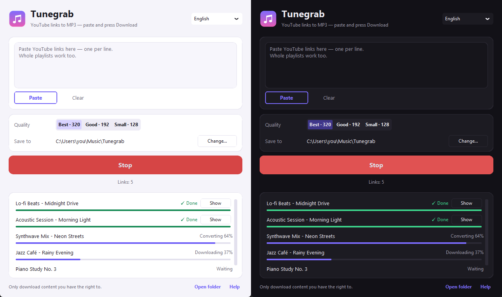
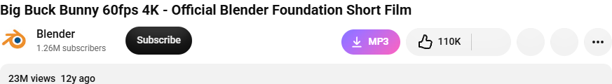

# Tunegrab

**Ссылки с YouTube в MP3. Вставил, нажал одну кнопку, готово.**

Маленькая бесплатная программа для Windows и кнопка MP3 для браузера (по желанию). Без рекламы, без аккаунта.

[English](README.md) · **Русский**

## Как пользоваться

1. **Скачай** `Tunegrab.exe` кнопкой выше и открой. Устанавливать ничего не нужно.
2. **Скопируй** ссылку с YouTube. Tunegrab сам подхватит её из буфера обмена (или нажми **Вставить**).
3. Нажми **Скачать MP3**. Файлы появятся в папке `Музыка\Tunegrab`. Кнопка **Показать** откроет нужный файл.

Всё.

## Кнопка MP3 в браузере (по желанию)

Поставь расширение **Tunegrab: кнопка MP3**, и под каждым видео на YouTube рядом с «Нравится» появится кнопка MP3 (на Shorts и в плейлистах она висит в углу). Один клик, и Tunegrab начинает скачивание. Ещё можно нажать правой кнопкой по ссылке на YouTube или на иконку Tunegrab на панели. Расширению нужна программа Tunegrab, данные оно не собирает ([конфиденциальность](PRIVACY.md)).

**Установка с GitHub (Chrome, Edge, Opera, Яндекс, Brave):**
1. Скачай `tunegrab-extension-chromium-….zip` из [последнего релиза](https://github.com/BukazLucky/tunegrab/releases/latest) и распакуй в папку, которую не будешь удалять.
2. Открой `chrome://extensions` (в Edge `edge://extensions`, в Яндексе `browser://extensions`) и включи **Режим разработчика**.
3. Нажми **Загрузить распакованное расширение** и выбери распакованную папку.
4. Открой видео на YouTube, нажми **MP3**, а когда браузер спросит про Tunegrab, поставь галочку **Всегда разрешать**.

## Возможности

- **Одно окно, одна кнопка.** Никаких непонятных настроек.
- **Плейлисты и много ссылок сразу:** целый плейлист или список ссылок, по одной на строку.
- **Аккуратные файлы.** В каждый MP3 записываются название, исполнитель и обложка, поэтому файл нормально выглядит в любом плеере и на телефоне.
- **Качество на выбор:** 320, 192 или 128 кбит/с.
- **Разбирается в ссылках.** Находит ссылки в любом скопированном тексте и убирает повторы. Песня, открытая из «Микса», скачается одна, а не весь бесконечный микс.
- **Не качает повторно** то, что уже есть в папке.
- **Сам поддерживает себя в рабочем состоянии.** Загрузчик обновляется раз в день, поэтому программа продолжает работать, когда YouTube что-то меняет.
- **11 языков**, выбирается сам по языку Windows.
- **Светлая и тёмная тема**, как в Windows.

## Первый запуск

**«Система Windows защитила ваш компьютер»?** У Tunegrab нет платного сертификата подписи, поэтому SmartScreen предупреждает о новой программе. Нажми **Подробнее → Выполнить в любом случае**. Весь исходный код лежит в этом репозитории.

**Разовая настройка.** При первом запуске Tunegrab скачивает загрузчик (около 65 МБ) с официальных страниц
[yt-dlp](https://github.com/yt-dlp/yt-dlp/releases) и [Deno](https://github.com/denoland/deno/releases) на GitHub и проверяет контрольные суммы SHA-256. Это занимает меньше минуты и нужно только один раз.

## Вопросы

**Не скачалось. Что делать?** Рядом с песней написана причина: закрытое видео, удалено, 18+, прямой эфир, нет интернета. Если «Не удалось скачать» пишет у многих песен, значит, YouTube что-то поменял. Загрузчик обновится сам, попробуй позже или завтра.

**Видео 18+ и «только для спонсоров»?** Нельзя. Для них нужен вход в аккаунт YouTube, а Tunegrab никогда не спрашивает твой аккаунт.

**Прямые эфиры?** Не поддерживаются. Скачай запись, когда эфир закончится.

**Собирает ли программа данные?** Нет. Она обращается только к YouTube (за звуком) и к GitHub (за загрузчиком, его обновлениями и проверкой новой версии Tunegrab).

**Ругается антивирус.** Программы, собранные через PyInstaller, иногда дают ложные срабатывания. Файл можно проверить на [VirusTotal](https://www.virustotal.com/) или собрать самому из исходников.

**Как удалить?** Удали `Tunegrab.exe` и папку `%LOCALAPPDATA%\Tunegrab`.

**Нашёл ошибку?** [Создай issue](https://github.com/BukazLucky/tunegrab/issues) и приложи файл `%LOCALAPPDATA%\Tunegrab\tunegrab.log`.

## Пользуйся честно

Tunegrab предназначен для контента, который тебе можно скачивать: свои видео, материалы под Creative Commons и общественное достояние, или то, что разрешил владелец. Скачивание чужой музыки без разрешения может нарушать правила YouTube и законы твоей страны. Ответственность за использование лежит на тебе. Tunegrab не связан с YouTube и Google.

## Лицензия

[MIT](LICENSE). Сторонние компоненты перечислены в [THIRD_PARTY_NOTICES.md](THIRD_PARTY_NOTICES.md).
